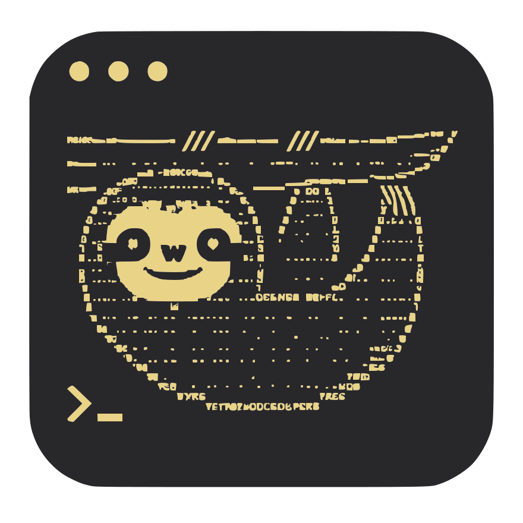
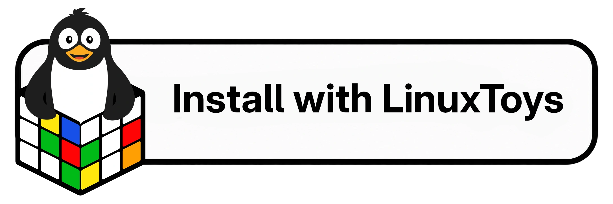

# sloth-bash

<div align="center">
  
  
  Use bash like a sloth. Veeeery lazy.
</div>

## One-liner install
`curl -fsSL https://raw.githubusercontent.com/psygreg/sloth-bash/main/install.sh | bash`

or...

<a href="linuxtoys://install/sloth-bash">
  
</a>

## Features
- **Intuitive response:** just the file name will run it if executable; run a `*.py` file with the local `venv`/`.venv` interpreter when present (without activating it into your shell); or trigger `xdg-open` for other cases.
- **Flatpak redirection:** simplifies running flatpak applications from terminal by making `flatpak run` obsolete through smart command handling. No more `io.github.kolunmi.Bazaar`, just `bazaar` will do the trick!
- **Easily open apps from terminal automatically detaching them** with `detach appname`. Perfect for usage with something like Quake Terminal for Gnome or `yakuake`. Also works with *flatpak redirection*, local executables, and *distrobox passthrough*.
- **`cp` and `mv` helpers:** large same-device file copies can show `rsync` progress; directories without `-r` are refused (like GNU `cp`); same-filesystem `mv` stays a real `mv`.
- **Simple file management in your shell:** automatic `ls` after `cd` so you never get lost in your files, and enabled *autocd* shell option so you can navigate your subdirectories more intuitively.
- **Most used zsh shortcuts**: `md`, `rd` (`rmdir`), `mkcd`, `take`, `~` and `..` work like zsh, while you can use `cd ...`, `cd ....` and `cd .....` for the other upwards navigation commands.
- **`all`**: selects all non-hidden files and subdirectories at its location as targets for `rd`, `rm`, `cp` and `mv`. `rm all` is interactive; `rd all` only removes empty directories.
- **Better autocompletion** with *Tab* key cycling through all options (Shift+Tab goes backwards when supported).
- **FZF shell bindings:** if *fzf* is installed, `sloth-bash` enables the standard Bash integration, including fuzzy history search on `Ctrl+R`.
- **Basic command colors:** enables colored output for `ls`, `dir`, `vdir` and `grep`, plus familiar aliases like `ll`, `la` and `l`.
- **Case-insensitive command parsing:** `ls`, `Ls`, `lS` or `LS`, your command will always work (exact name match, not regex).
- **Distrobox passthrough:** enter your distrobox shell with `distroboxname` and pass commands to your distroboxes running `distroboxname command` (and any additional arguments if needed after). As distroboxes follow the user's *`~/.bashrc`* file, sloth-bash also works from within them!

## Optional integrations
- **Starship** is installed by the installer when missing (recommended).
- **fzf** is installed by the installer when missing.
- **Zellij** auto-start is **opt-in**: set `SLOTH_BASH_ZELLIJ=1` in your environment before sourcing sloth-bash.

## Recommended usage
- Install *[Starship](https://starship.rs)* for the complete experience.
- Install *[fzf](https://github.com/junegunn/fzf)* if you want the full fuzzy shell bindings.
- Copy **sloth-bash** to **`~/.sloth-bash`**
- Copy **alias-list** to **`~/.alias-list`** (customize Flatpak aliases here; updates do not overwrite it)
- Copy **starship.toml** to **`~/.config/starship.toml`** only if you do not already have one
- Add **`source ~/.sloth-bash`** to the end of your `~/.bashrc` file

## Tests
```bash
bash tests/run.sh
```
